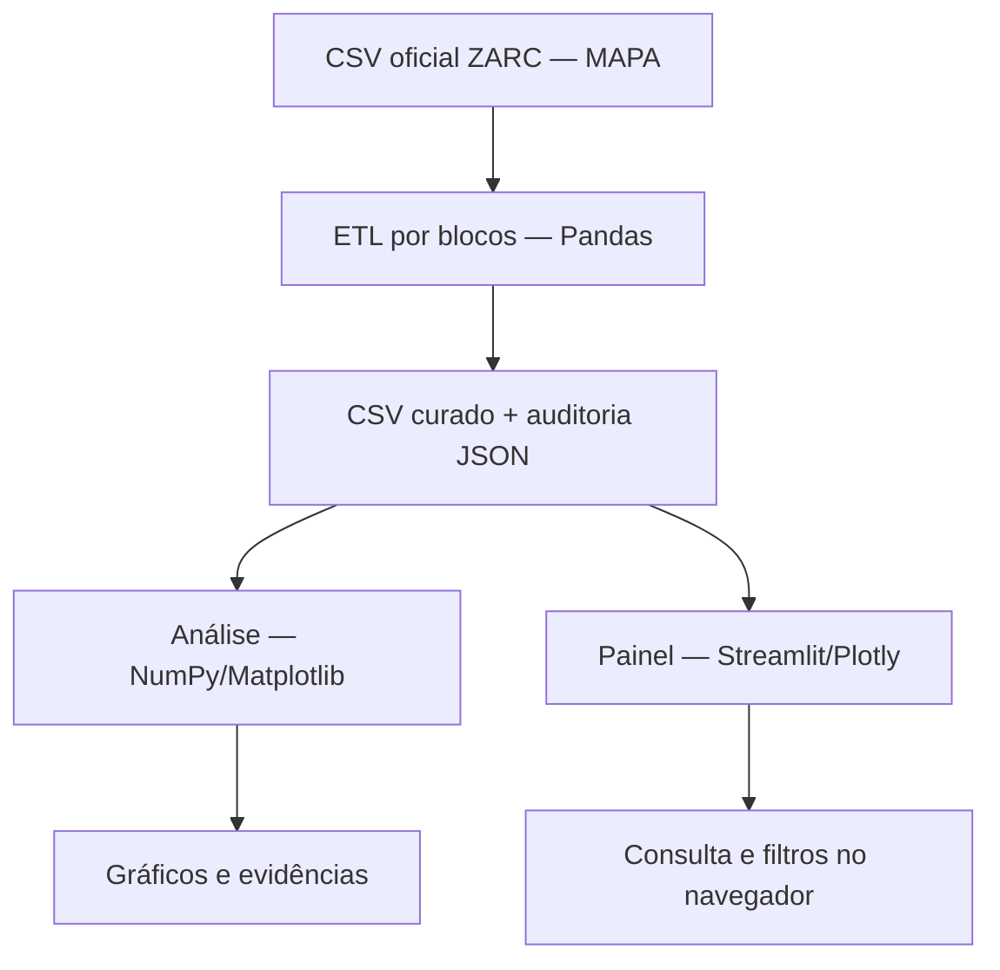

# Roteiro sugerido dos slides — Global Solution Voz da Terra

**Uso:** textos-base prontos para o grupo adaptar ao template oficial. Antes de entregar, verificar número máximo de slides e critérios exatos na área da disciplina. Onde houver `[ ]`, preencher com informação real. Não apresentar funcionalidades planejadas como desenvolvidas.

## Slide 1 — Capa

**Voz da Terra**  
*Dados oficiais do ZARC traduzidos em janelas de plantio mais compreensíveis*  
Global Solution — FIAP | Ciência de Dados | 2026/2  
Equipe: `[NOMES COMPLETOS E RMs]`

## Slide 2 — Desafio e contexto

Decisões de plantio são sensíveis ao clima, ao solo e ao grupo de cultivar. Os dados técnicos públicos do Zoneamento Agrícola de Risco Climático (ZARC) são importantes, mas seu formato tabular e linguagem especializada criam barreiras de consulta. O desafio não é inventar previsões, e sim **facilitar o acesso e a interpretação responsável de informação oficial**, sem apagar as condições técnicas.

## Slide 3 — Público e ecossistema

- **Público prioritário:** agricultores familiares e pequenos produtores de feijão, com apoio de técnicos de extensão rural.
- **Atores relevantes:** MAPA (fonte do ZARC), entidades de assistência técnica, cooperativas e secretarias rurais.
- **Recorte territorial do MVP:** 853 municípios de Minas Gerais presentes no CSV para Feijão/Sequeiro — não bairros nem propriedades geolocalizadas.
- **Barreiras a considerar:** conectividade, alfabetização digital e necessidade de mediação por técnico/agente.

## Slide 4 — Ideia e proposta de valor

O **Voz da Terra** organiza janelas oficiais do ZARC em um painel com consulta por município, solo, grupo de cultivar, limite de risco e período do calendário. A interface mostra a abrangência das indicações, seus limites e de onde os dados vieram. **Visão futura, fora do MVP:** distribuir explicações por mensagens de voz em canais acessíveis.

## Slide 5 — Dados públicos: escolha baseada em evidências

- Fonte: CSV aberto do **MAPA/ZARC, safra 2026/2027**.
- Auditoria nacional: **1.189.856 linhas**, **22 culturas**, **27 UFs**, **5.571 municípios identificados**.
- Recorte selecionado após auditoria: **Feijão / MG / Sequeiro**, **8.025 registros**, **853 municípios**, seis classes de solo e dois grupos de cultivar.
- **Granularidade:** município × cultura × solo × grupo de cultivar × manejo × decêndio; não há previsão diária ou bairro.
- Exceção documentada: 10 linhas de Girassol/RS sem nome de município foram excluídas de contagens territoriais.

**Evidência para inserir:** trecho de `reports/auditoria.json` e fonte oficial no rodapé.

## Slide 6 — Solução e funcionalidades entregues

- Pipeline **Pandas** para validar, filtrar e curar o CSV original.
- Módulo analítico **NumPy + Matplotlib**: estatística descritiva e hipótese exploratória.
- Dashboard **Streamlit + Plotly**: filtros, KPIs, gráficos de linha, barras e mapa de calor.
- Layout reorganizado para consulta pelo **celular**: busca por município, opções por toque e gráficos empilhados. **Responsividade técnica implementada; acessibilidade com produtores ainda precisa ser validada.**
- Arquivo curado comprimido e metadados auditáveis no repositório.

**Evidência para inserir:** capturas reais do Streamlit em computador **e no navegador de um celular**, com filtros à vista. Não usar imagens geradas artificialmente como captura do produto.

## Slide 7 — Três descobertas dos dados

1. **A cobertura depende do limite de risco:** 663 municípios têm pelo menos um período indicado até 20%, contra 774 até 30% e 853 até 40%. São conjuntos aninhados, não números somáveis.
2. **Há concentração temporal:** os períodos com alguma indicação ficam nos **decêndios 28–36**; no decêndio 31, há 850 municípios com alguma combinação indicada até 40%.
3. **Solo importa:** ao fixar grupo I e limite 20%, 363 municípios pareados apresentaram, em média, **3,198 decêndios a mais** na classe AD3 do que AD1; teste exploratório de permutação, p ≈ 0,0005. **Associação no arquivo, não causalidade ou recomendação agronômica individual.**

**Evidências para inserir:** `reports/figuras/01_...png`, `02_...png`, `03_...png` e `reports/analise.json`.

## Slide 8 — Arquitetura da demonstração

**Nota:** mensageria e áudio são propostas de evolução, não serviços conectados ao MVP.

## Slide 9 — Benefícios e impacto esperado

- **Benefício funcional demonstrado:** transformar um arquivo oficial complexo em consulta navegável, com contagens verificáveis.
- **Benefício esperado, ainda não medido:** reduzir barreiras de interpretação e apoiar conversas entre produtor e assistência técnica.
- **Indicadores propostos para piloto futuro:** tempo para localizar indicação correta, acerto de interpretação por perfil de solo/cultivar, satisfação e acessibilidade.
- Não existem dados de usuários testados, produtividade adicional ou perdas evitadas no MVP.

## Slide 10 — ODS, ética e limites

- **ODS 2 — Fome Zero e Agricultura Sustentável:** melhor compreensão de informação de apoio à produção.
- **ODS 13 — Ação Contra a Mudança Global do Clima:** acesso responsável a informações de risco climático agrícola.
- **ODS 10 — Redução das Desigualdades:** inclusão como objetivo de design futuro, sujeito a teste de acessibilidade.
- Riscos: simplificação excessiva, falsa impressão de precisão e exclusão digital. O MVP não coleta dados pessoais; um sistema futuro com telefone/localização demandaria políticas de privacidade e proteção de dados.

## Slide 11 — Próximos passos e limitações

**Entregue:** ETL, exploração dos dados, dashboard Streamlit, testes e documentação.  
**Próximo passo:** validação com agrônomos e extensionistas, testes de compreensão com produtores, mecanismos de atualização das portarias e avaliação de canais de voz acessíveis.  
**Limite fundamental:** ZARC é zoneamento oficial de risco para condições específicas, **não** previsão do tempo, sensor em tempo real ou autorização universal de plantio.

## Slide 12 — Fontes, repositório e apresentação

- **Repositório:** https://github.com/tamaracostadev/voz-da-terra
- **MAPA/ZARC:** link para CSV e dicionário oficial no [README](../README.md).
- **Base e figuras:** `reports/auditoria.json`, `reports/analise.json` e `reports/figuras/`.
- **Pitch público:** `[INSERIR URL DO VÍDEO APÓS PUBLICAÇÃO]`.
- **Integrantes:** `[NOMES/RMs]`.

---

## Checklist de entrega (grupo)

- [ ] Confirmar exigências, limite de páginas e critérios da turma com a documentação da disciplina.
- [ ] Preencher capa, nomes completos e RMs de todos os membros.
- [ ] Rodar `streamlit run dashboard/app.py` e capturar imagem real das três visualizações.
- [ ] Abrir o painel no navegador de um celular e conferir filtros, legibilidade e gráficos; ajustar caso haja corte de texto.
- [ ] Distribuir gráficos com legendas e fontes verificáveis; revisar o texto para caber no template.
- [ ] Preparar PDF final dos slides conforme o portal pedir.
- [ ] Gravar pitch **com até cinco minutos**, publicar com a visibilidade exigida e inserir o link.
- [ ] Revisar formulário/portal de entrega e enviar tudo **até 19/11/2026, 23h59 (horário de Brasília)**, conforme enunciado consultado.
