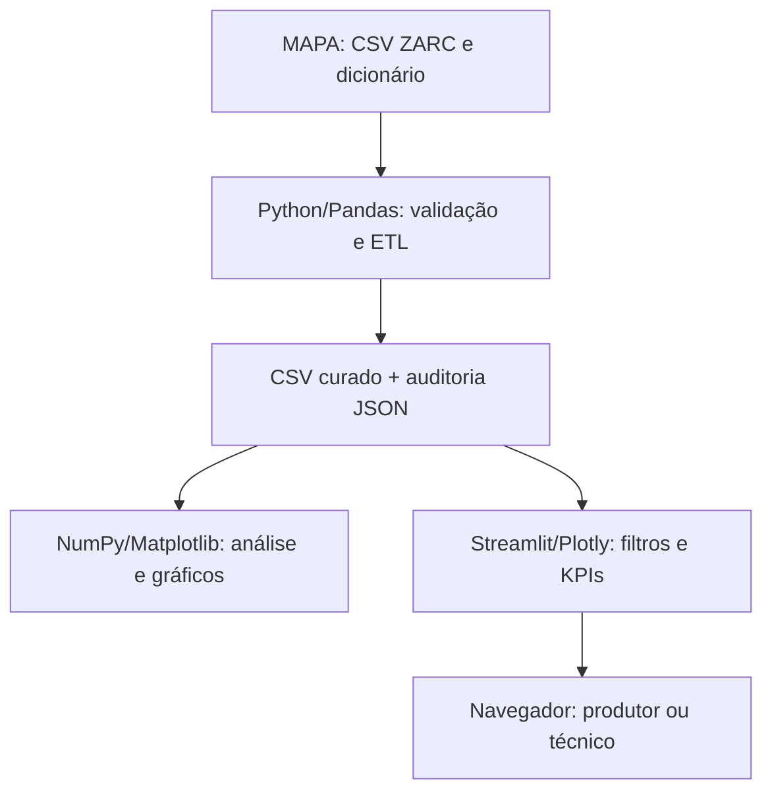

# Voz da Terra — roteiro V2 alinhado ao template oficial da GS 2026.2

Este roteiro segue **a ordem e os campos dos slides 1 a 13** do arquivo `GS_2026_2_-_1TSCO_A_B_template_v1.pptx`, disponibilizado pela FIAP. Os slides 14 a 20 são exemplos de inspiração e devem ser **removidos antes da exportação do PDF**.

**Uso:** os blocos **Texto para o slide** são sugestões de conteúdo para copiar e adaptar ao template. Os blocos **Evidência e pendências** orientam o grupo e não devem ser copiados como texto de apresentação. Os valores vêm dos arquivos auditados do projeto; não são estimativas de impacto social. Onde houver `[PREENCHER]`, falta uma informação ou evidência real.

## Slide 1 — Abertura institucional: CitizenTech

**Texto para o slide:** manter a abertura institucional do template (Global Solution 2026.2 / Data Science / CitizenTech).

**Evidência e pendências:** conferir se a turma exige preservar esta abertura. Não inserir resultados ou alterar a identidade FIAP sem necessidade.

## Slide 2 — Logotipo, nome do projeto e identificação da equipe

**Texto para o slide**

- **Voz da Terra**
- **Proposta:** janelas oficiais de plantio do feijão explicadas em um painel de consulta acessível pelo navegador.
- **Turma:** `1TSCO[PREENCHER A OU B]`.
- **Integrantes, em ordem alfabética:** `[NOME COMPLETO — RM]` de cada integrante.
- **Aluno(a) responsável:** `[PREENCHER NOME E RM]`.
- **Logotipo do projeto:** `[INSERIR ARQUIVO/IMAGEM]`.

**Evidência e pendências:** confirmar grafia, quantidade de integrantes, RMs, turma e responsável com o grupo; não inventar identidades. O template reserva um campo visual para o logotipo.

## Slide 3 — Contextualização e recorte do problema

**Texto para o slide**

- **Problema:** a consulta às tabelas técnicas do Zoneamento Agrícola de Risco Climático (ZARC) exige interpretar município, solo, grupo de cultivar, manejo, período de plantio e limite de risco. Isso torna valiosa uma visualização com linguagem mais direta.
- **Território:** Minas Gerais; feijão em sistema de sequeiro; safra 2026/2027. A granularidade dos dados é **municipal**, sem coordenadas de lavouras ou bairros.
- **Evidência do arquivo oficial:** o recorte contém **8.025 registros**, **853 municípios**, **seis classes de água disponível no solo** e **dois grupos de cultivar**. As indicações estão nos decêndios **28 a 36**.
- **Contexto da agricultura familiar em MG:** segundo o **Censo Agropecuário 2017**, Minas Gerais possuía cerca de **441,8 mil estabelecimentos de agricultura familiar**. Isso não corresponde à quantidade de produtores de feijão ou usuários do projeto.
- **Contexto de acesso digital:** na pesquisa **TIC Domicílios 2025**, **85% dos domicílios rurais brasileiros não tinham computador** (desktop, notebook ou tablet). É um dado **nacional**, não específico de Minas Gerais nem de agricultores de feijão.
- **Persona de referência, construída com pesquisa secundária:** produtor(a) familiar de feijão de sequeiro em MG que precisa consultar indicações para seu município, solo e cultivar, possivelmente pelo celular ou com mediação de assistência técnica. **As dificuldades individuais são hipóteses, não resultados de entrevistas.**
- **Recorte do problema:** apoiar a **consulta e compreensão** de indicações já publicadas pelo MAPA, sem gerar previsão meteorológica ou recomendação individual para a propriedade.

**Evidência e pendências:** citar **MAPA/ZARC**, **Censo Agropecuário 2017 (via Agência Minas)** e **Cetic.br 2025** no próprio slide. São pesquisas e situações reais suficientes para **fundamentar uma persona proposta**; não constituem validação direta com usuários de feijão em MG. A abrangência do CSV prova disponibilidade dos dados, **não prova sozinha** a dificuldade vivida por produtores. Entrevistas podem ser planejadas como próxima etapa, sem dizer que ocorreram.

## Slide 4 — Proposta de solução

**Texto para o slide**

- **O que é:** painel web **Voz da Terra**, desenvolvido em Streamlit, que torna consultáveis as janelas oficiais do ZARC.
- **Funcionalidades implementadas:** busca por município, filtros por AD1–AD6, grupo de cultivar I/II, decêndios e limite de risco (até 20%, 30% ou 40%); KPIs, três gráficos, explicações e download dos registros filtrados.
- **Informação entregue:** municípios com ao menos uma indicação nas condições consultadas e os períodos indicados no arquivo oficial, com fonte e limitações visíveis.
- **Inclusão no MVP:** layout adaptado a telas pequenas, linguagem direta e explicação das classes de solo; **a experiência com usuários reais e leitores de tela ainda não foi validada**.
- **Conectividade:** o site necessita de internet quando implantado remotamente. Uso por técnico de extensão pode auxiliar quem tem dificuldade digital; a mediação **não foi testada**.
- **Futuro, fora do MVP:** áudios e mensagens curtas em canais de baixo atrito, dependentes de validação de conteúdo, privacidade e custos.

**Evidência e pendências:** mostrar telas verdadeiras do painel. Não afirmar que existe WhatsApp, SMS, áudio, alertas automáticos, aplicativo nativo, acesso offline ou previsão em tempo real.

## Slide 5 — Público beneficiado e ecossistema

**Texto para o slide**

**Público beneficiado — quem usaria e do que precisa**

- **Agricultores familiares e pequenos produtores de feijão:** consulta clara no celular às janelas relacionadas ao município, à classe de solo e ao cultivar; necessidade de explicações simples e acesso com pouca familiaridade digital.
- **Técnicos e extensionistas rurais:** visualizar fontes, filtros e condições técnicas para apoiar o diálogo com o produtor, sem substituir avaliação agronômica.
- **Cooperativas e associações rurais:** possível apoio coletivo à divulgação e à orientação; uso institucional ainda não validado.

**Ecossistema — participação e conexão com a solução**

- **MAPA:** publica os dados e as portarias oficiais do ZARC, consumidos pelo pipeline do projeto. **É fonte de dados, não parceiro formal do grupo.**
- **Equipe Voz da Terra:** obtém o CSV público, valida os códigos, executa o tratamento e disponibiliza o painel e a documentação.
- **Assistência técnica rural, cooperativas e associações:** **atores potenciais** para validar linguagem, divulgar a ferramenta e mediar a consulta com produtores. Não há parceria firmada documentada.
- **Usuários finais:** consultam os resultados e, em uma etapa futura, poderiam informar dificuldades de interpretação para melhorar a interface.

**Evidência e pendências:** adicionar um pequeno fluxo `MAPA → equipe/painel → técnicos e produtores` e indicar quais atores são fonte oficial, executores ou possíveis apoiadores. Confirmar parcerias antes de citar instituições específicas como participantes ativos.

## Slide 6 — Benefícios e impactos esperados

**Texto para o slide**

- **Resultado já demonstrado:** transformar **8.025 registros oficiais** em um painel filtrável, com consulta a **853 municípios** e contagens rastreáveis.
- **Benefício esperado:** tornar a leitura das janelas do ZARC mais rápida e compreensível para produtores e profissionais de apoio, preservando as condições técnicas de cada indicação.
- **Indicador 1 (piloto):** tempo mediano para localizar uma indicação correta para município, solo, cultivar e risco.
- **Indicador 2 (piloto):** percentual de respostas corretas em tarefas de interpretação do painel, comparado à consulta direta à tabela original.
- **Indicador 3 (piloto):** taxa de conclusão das tarefas no celular, com e sem ajuda de um técnico, inclusive entre participantes com baixa familiaridade digital.
- **Expansão possível:** reprocessar outras culturas, safras e UFs **após verificar cobertura, portarias e compatibilidade dos campos**.

**Evidência e pendências:** os indicadores são **propostos**, sem linha de base, meta, amostra ou resultados de usuários. Planejar protocolo de teste e metas com o grupo antes de apresentar qualquer melhoria percentual. **Não** afirmar perdas evitadas, aumento de produtividade ou quantidade de produtores alcançados.

## Slide 7 — ODS atendidas pela solução

**Texto para o slide**

- **ODS 2 — Fome Zero e Agricultura Sustentável, meta 2.4:** a proposta facilita a consulta a informações públicas de risco climático relacionadas ao planejamento do plantio. **Contribuição potencial**, sem produtividade adicional medida.
- **ODS 13 — Ação Contra a Mudança Global do Clima, meta 13.3:** a interface pode favorecer a compreensão de informações de risco climático agrícola. **Não mede adaptação real nem prevê eventos extremos.**
- **ODS 10 — Redução das Desigualdades:** relação **aspiracional** pela proposta de inclusão digital; evidência de impacto depende de testes com públicos com diferentes níveis de acesso.
- **Indicadores acompanháveis:** número de municípios e janelas indicadas no arquivo (**cobertura informacional**); em piloto futuro, compreensão correta e conclusão de tarefas por perfil.

**Evidência e pendências:** destacar visualmente **ODS 2 e 13** no quadro do template. ODS 10 pode aparecer como objetivo secundário condicionado à validação, sem exagerar impacto. Referenciar ONU Brasil para as metas.

## Slide 8 — Tecnologia aplicada

**Texto para o slide**

| Etapa | Tecnologia e uso real no MVP |
| --- | --- |
| Coleta | Download do CSV público ZARC 2026/2027 (MAPA) e consulta ao dicionário/portaria. |
| Tratamento | Python + Pandas: leitura por blocos, validação, filtro e padronização de geocódigos. |
| Armazenamento | CSV curado compactado (`.csv.gz`) e relatórios JSON no repositório. |
| Análise | Pandas + NumPy: estatísticas, comparações e teste exploratório de permutação. |
| Evidência analítica | Matplotlib: três gráficos estáticos reproduzíveis. |
| Visualização e interação | Streamlit + Plotly: indicadores, filtros e gráficos no navegador. |
| Versionamento | GitHub: código-fonte, testes, documentação e resultados auditáveis. |

**Evidência e pendências:** não incluir banco, nuvem, API de clima, inteligência artificial preditiva ou mensageria como tecnologia **implementada**. O projeto atual não depende desses serviços.

## Slide 9 — Arquitetura de solução

**Texto para o slide**

- **Fluxo:** coletar dados oficiais, validar e selecionar o recorte, preservar o resultado curado, calcular indicadores por município/solo/cultivar/decêndio e disponibilizar a consulta web.
- **Modelo analítico:** regras de filtragem e agregação e uma hipótese exploratória. **Não há treinamento de IA ou modelo de previsão climática.**

**Evidência e pendências:** converter o diagrama em **imagem legível** para o slide 9, acompanhada de descrição curta dos componentes. A figura só deve conter serviços que existem no MVP; mensageria por áudio pode ser indicada separadamente como evolução.

## Slide 10 — Demonstração de recursos esperados (protótipo/MVP)

**Texto para o slide**

- **MVP funcional:** painel Streamlit com busca por município, escolha de risco, solo, cultivar e decêndios, além de indicadores e três visualizações.
- **Exemplo de leitura:** um município só entra na contagem de um período se houver **ao menos uma combinação** de solo e grupo de cultivar indicada no ZARC.
- **Uso no celular:** filtros no corpo da página e gráficos em sequência. É uma interface web responsiva, **não um aplicativo nativo/offline**.

**Evidência e pendências:** inserir `[CAPTURA REAL DO DASHBOARD NO DESKTOP]` e `[CAPTURA REAL NO NAVEGADOR DE CELULAR]`, preferencialmente mostrando filtros e resultados. **As duas capturas e a validação visual mobile ainda estão pendentes.** Não substituir prints por imagem sintética.

## Slide 11 — Uso responsável dos dados

**Texto para o slide**

**Privacidade e segurança**

- O MVP consulta **dados públicos do MAPA** e **não solicita cadastro, CPF, telefone, endereço da propriedade ou geolocalização precisa**.
- O repositório contém dados oficiais curados e agregações, sem banco de usuários. Não há mecanismo de consentimento pessoal no MVP porque a interface não pede dados pessoais diretamente.
- Em implantação pública, a operação do servidor e provedores de hospedagem **podem processar dados técnicos de acesso**; a política de logs e retenção ainda deve ser definida antes do lançamento.
- Uma versão futura com mensagens personalizadas exigirá avaliação jurídica/LGPD, transparência, base legal apropriada, controle de acesso, retenção e exclusão.

**Vieses e inclusão**

- **Cobertura e agregação:** o CSV descreve condições de portarias por município, **não a aptidão de cada propriedade**, a quantidade de produtores ou perdas reais.
- **Exclusão digital:** acesso à internet, letramento e disponibilidade de dispositivos são barreiras possíveis; o painel atual precisa de conexão.
- **Mitigações existentes:** texto explicativo, aviso sobre limites do ZARC, busca simples e interface adaptada a telas menores.
- **Mitigações a validar:** testes com produtores e pessoas com deficiência, revisão de especialistas, contraste/navegação por teclado, mediação por extensionistas e futuro estudo de áudio.

**Evidência e pendências:** não declarar conformidade LGPD, auditoria de acessibilidade ou consentimento implementados sem avaliação. Descrever como o grupo identificará vieses durante testes e ajustará a linguagem e a interface.

## Slide 12 — Painel de Data Visualization (BI, Analytics & Data Visualization)

**Texto para o slide**

**01 — Dados e KPIs.** Fonte: **MAPA/ZARC 2026/2027**. Python valida códigos e municípios do CSV e seleciona **Feijão / MG / Sequeiro**. Indicadores: **municípios consultados**, **municípios com indicação** e **decêndios indicados**.

**02 — Três visualizações e suas funções.**

1. **Linha:** evolução da cobertura entre decêndios da mesma safra.
2. **Barras:** ranking comparável de períodos por município.
3. **Mapa de calor:** distribuição das indicações por solo e decêndio.

**03 — Interatividade e boas práticas.** Filtros por **município, decêndio, solo, cultivar e risco**. Títulos, eixos e textos explicativos indicam o escopo; cores distinguem séries e intensidades. **Acessibilidade visual ainda precisa de validação manual.**

**04 — Três insights principais.**

1. **Risco:** **663 / 774 / 853 municípios** com indicação até **20% / 30% / 40%**, respectivamente.
2. **Calendário:** indicações nos decêndios **28–36**; pico no **31**, com **850 municípios** até 40%.
3. **Solo:** em **363 municípios pareados**, AD3 apresentou média de **3,198 decêndios a mais** que AD1 (grupo I; até 20%).

**Evidência e pendências:** no insight 1, os totais são **conjuntos aninhados**, não somáveis. No 2, o eixo temporal é uma sequência de **decêndios dentro da safra**, não série de anos ou previsão do tempo. No 3, a diferença resulta de **teste exploratório de permutação (p ≈ 0,0005)**; **não** é causalidade ou recomendação para propriedade. Os números fixos são de `reports/analise.json`, sem filtros adicionais. Anexar captura real do painel e **código-fonte** `dashboard/app.py`, módulos `src/voz_da_terra/`, dados curados e instruções de execução. As figuras em `reports/figuras/` são evidências adicionais. Acessibilidade ainda carece de avaliação manual.

## Slide 13 — Link do vídeo pitch

**Texto para o slide**

- **Vídeo pitch (YouTube, público, até 5 minutos):** `[INSERIR LINK PÚBLICO VALIDADO]`.
- **Código-fonte:** https://github.com/tamaracostadev/voz-da-terra

**Evidência e pendências:** gravar/editar, publicar no YouTube com visibilidade **pública**, abrir o link sem login e conferir duração máxima de cinco minutos. O roteiro-base está em `docs/pitch.md`.

---

## Conferência final antes da entrega

- [ ] Usar os slides **1–13** do template oficial e **remover os slides de exemplos 14–20** antes de exportar.
- [ ] Preencher **turma (A/B), nomes completos, RMs, responsável e logotipo**.
- [ ] Preservar **fontes junto dos dados** e esclarecer que a TIC Domicílios é nacional, não medição específica de agricultores de MG.
- [ ] Não declarar pesquisa de campo, parceria, impacto ou redução de perdas se não houver evidência real.
- [ ] Inserir **diagrama da arquitetura**, **prints reais do Streamlit** (desktop e celular) e **código-fonte do painel**.
- [ ] Revisar legibilidade, eixos, cores, contraste, informações de risco, português e tamanho do texto dentro do layout FIAP.
- [ ] Gravar **pitch de até 5 minutos**, publicar com acesso público e inserir URL no slide 13.
- [ ] Gerar **PDF final**, confirmar a exigência específica de anexos na plataforma **ON — Fase 7** e submeter **até 19/11/2026, 23h59 (horário de Brasília)**, sem contar com envio tardio.

## Fontes e rastreabilidade

- **FIAP:** [orientações da Global Solution CitizenTech](https://drive.google.com/file/d/1-Qg4V6o_dztV-uB3DQfChKeS7-qZaiDR/view) e [template de slides](https://drive.google.com/file/d/1D_P7dxcMoTefHNOAmwfHRakk9FihHcYq/view).
- **MAPA:** [CSV da tábua de risco ZARC 2026/2027](https://dados.agricultura.gov.br/dataset/6d3d141c-885e-41a4-ab7f-dc8ff323b96f/resource/139e5a60-1f43-4cc8-aeab-a35dbbf816c0/download/dados-abertos-tabua-de-risco-safra-2026-2027.csv); [dicionário de dados](https://dados.agricultura.gov.br/dataset/6d3d141c-885e-41a4-ab7f-dc8ff323b96f/resource/bebb0ebb-bc75-460c-b900-a7a1ebd87bee/download/dicionario-de-dados-tabua-de-risco-2026.pdf); [portaria de Feijão/Sequeiro em MG, safra 2026/2027](https://www.gov.br/agricultura/pt-br/assuntos/riscos-seguro/programa-nacional-de-zoneamento-agricola-de-risco-climatico/portarias/safra-vigente/minas-gerais/POA2201.PDF/@@download/file).
- **Projeto:** `reports/auditoria.json`, `reports/analise.json`, `docs/metodologia.md` e `reports/figuras/` documentam contagens, estatística e limites.
- **Cetic.br/NIC.br:** [TIC Domicílios 2025, indicador A1 (computador em domicílios rurais)](https://cetic.br/pt/tics/domicilios/2025/domicilios/A1/).
- **IBGE / Governo de Minas:** [Agência Minas — estabelecimentos de agricultura familiar em MG, conforme Censo Agropecuário 2017](https://www.agenciaminas.mg.gov.br/noticia/minas-gerais-e-o-2-estado-brasileiro-com-mais-agricultores-familiares-114590).
- **ONU Brasil:** [ODS 2 e meta 2.4](https://brasil.un.org/pt-br/sdgs/2) e [ODS 13 e meta 13.3](https://brasil.un.org/pt-br/sdgs/13).
